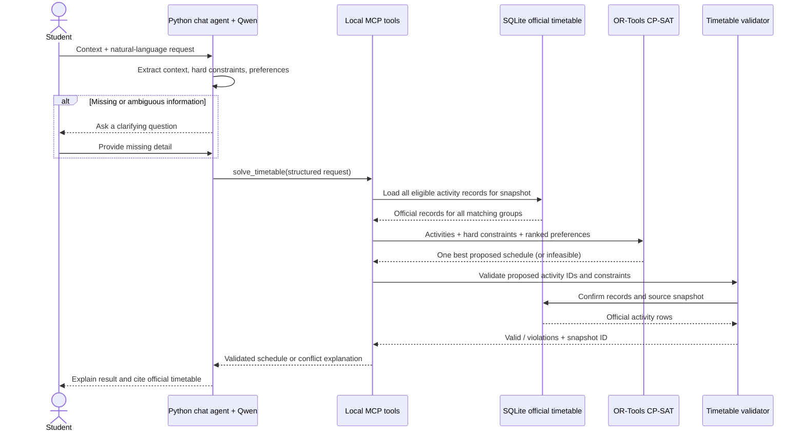

# Milestone 2 — Architecture and Project Plan

> **Status:** Proposed implementation plan
> **Project:** Student Timetable Organizer
> **Related:** [Project RFC](RFC.md)
> **Target:** UBB Cluj, Faculty of Mathematics and Computer Science

## Summary

We are building a timetable assistant for students. A student tells the assistant their specialization, language, year, semester, group and subgroup, then asks a timetable question or describes their preferences in natural language. The assistant answers from the official timetable, or proposes a conflict-free personal timetable that respects the student's hard constraints and ranks the options by their preferences.

The core of the system is a three-step pipeline:

1. **Interpret.** Qwen turns the student's message into a validated, structured request: the student's context, their hard constraints and their ranked preferences.
2. **Solve.** Python loads every eligible official timetable record for that context and passes them, together with the structured request, to an OR-Tools solver.
3. **Verify.** A separate validator checks each selected activity against the same official timetable snapshot, verifies coverage and conflicts, and rejects any result that cannot be traced back to the source data.

We use RAG to find relevant timetable records when answering conversational questions. The solver and the validator, however, work on the complete structured records in SQLite, so a handful of retrieved results can never limit or certify a schedule.

### Changes in scope since the RFC

The RFC mentioned calendar export and prerequisite rules. After looking at the official data, we decided to narrow the first version:

- **Prerequisites** are not published in the timetable pages, so we could not check them against official data. We have left them out.
- **Calendar export** (iCalendar) is a stretch goal for Week 13, if the core pipeline is finished on time. It does not change the architecture, since it only formats an already validated schedule.

### Terms

| Term | Meaning |
|---|---|
| **Official timetable** | The faculty's published schedule for one academic year and semester. |
| **Personal timetable** | The set of activities selected for one student. |
| **Group alternative** | A seminar/lab of the same activity in another group of the same specialization, language and year. Proposing it does not mean the teacher has approved attendance. |
| **Refused alternative** | A specific group alternative the student reports they cannot attend. |
| **Hard constraint** | A requirement the schedule must satisfy (e.g. "I cannot attend Friday"). |
| **Preference** | A desired property that may be traded off (e.g. "I'd rather avoid 8:00 classes"). |

## 1. Problem, scope, and data

### 1.1 Problem

Today, students go through the timetable pages and compare group, seminar and lab options by hand. The number of combinations grows quickly. On top of that, a student may want to avoid early classes or keep a day free, or may be unable to attend another group's lab because the teacher refused the change.

Our assistant handles timetable questions and personal timetable organization. It does not answer questions about course content, prerequisites or course descriptions.

### 1.2 Supported student context

Each request covers one academic year and semester. The student provides the following, and the assistant asks for anything missing:

- specialization;
- teaching language;
- study year (three or four years, depending on the specialization);
- current group and subgroup, where applicable;
- the academic year and semester they are asking about.

We take the published timetable of the student's group as the starting schedule. In the first version, lectures stay with that group, while switching seminar and lab groups is a core feature. A proposed group alternative does not mean the teacher has approved it, so the student can report a refused alternative and we exclude it from later schedules.

### 1.3 Official data source

Our data comes from the official timetable pages of UBB's Faculty of Mathematics and Computer Science. The URL encodes the academic year and semester, for example:

- [2026–2027, semester I](https://www.cs.ubbcluj.ro/files/orar/2026-1/)
- [2025–2026, semester I](https://www.cs.ubbcluj.ro/files/orar/2025-1/)
- [Tabular timetable index](https://www.cs.ubbcluj.ro/files/orar/2026-1/tabelar/index.html)
- [Example student timetable](https://www.cs.ubbcluj.ro/files/orar/2025-1/tabelar/I1.html)

Official timetables are available from 2014 onwards. The app fetches only the semester the student asks about and never downloads old semesters on its own. For that semester, it fetches the pages of all groups and subgroups in the student's specialization, language and year, so the solver can consider every legitimate alternative.

In the first version we parse the official HTML pages only, without PDF or spreadsheet adapters. Each table row contains the day, time, frequency, room, formation (cohort/group/subgroup), activity type, discipline and teacher. The frequency column marks alternating activities: `sapt. 1` means the activity takes place in odd weeks (week 1, 3, 5, …) and `sapt. 2` in even weeks (week 2, 4, 6, …). An empty frequency means every week. We store both the published label and the derived week pattern (`all`, `odd`, `even`), and the solver uses the pattern when checking overlaps.

### 1.4 Fetching, parsing, and caching

`fetch_timetable(academic_year, semester, specialization, teaching_language, study_year, refresh)` builds the official UBB URL from the year and semester, so the model can never point the tool at an arbitrary URL. The other arguments select which timetable pages to parse. The tool:

1. opens the official semester index and follows the links for the requested specialization, language and study year;
2. parses the HTML rows into complete activity records;
3. checks required fields, valid time ranges, known activity types and duplicates;
4. stores the records in SQLite, together with the source URL, fetch time and snapshot ID;
5. adds or updates the searchable activity text in the persistent Chroma collection.

The cache is keyed by academic year, semester, specialization, language and study year. A refresh only replaces the cached data once the new data has parsed successfully. Every refresh creates a new `snapshot_id` and keeps the previous one, and we produce a diff report (activities added, removed, or moved in time or room) so both the student and we can see what changed. Only the changed records are re-embedded in Chroma. A new semester or a new specialization goes through the same path, with no code changes as long as the page layout stays the same. If a fetch fails, the assistant says so and shows when the cached snapshot was fetched before falling back to it.

Each record stores at least:

```text
activity_id, academic_year, semester, specialization, teaching_language, study_year,
course_name, activity_type, group, subgroup, day, start_time, end_time,
room, teacher, frequency_label, week_pattern, source_url, fetched_at, snapshot_id
```

One record is one complete scheduled activity. We keep the group and subgroup on every record so the solver can compare alternatives directly, without stitching together partial text fragments.

## 2. From natural language to a checked schedule

### 2.1 Turning the request into a structured form

The Python agent passes the current conversation and the known student context to Qwen. Qwen returns a structured request, not a timetable, and Python validates every field before any tool is called. If the student's context is incomplete, or it is unclear whether something is a requirement or a preference, the assistant asks first.

Example student request:

> “Keep Friday free, avoid classes before 10, and don’t use group 214’s databases lab. I’m in Romanian Computer Science, year 1, group 211.”

The structured solver input we expect from it:

```json
{
  "context": {
    "academic_year": "2026-2027",
    "semester": 1,
    "specialization": "Computer Science",
    "teaching_language": "Romanian",
    "study_year": 1,
    "group": "211"
  },
  "hard_constraints": [
    {"type": "free_day", "day": "Friday"},
    {
      "type": "refused_alternative",
      "course": "Databases",
      "activity_type": "Laborator",
      "group": "214"
    }
  ],
  "preferences": [
    {"type": "not_before", "time": "10:00", "priority": 1}
  ]
}
```

We treat “I cannot attend Friday” as a hard constraint and “I would prefer Friday free” as a preference that can be traded off. When the wording does not make this clear, the assistant asks. A teacher refusal reported by the student is a hard exclusion of that specific alternative for the selected semester.

### 2.2 Solving against the official records

The `solve_timetable` tool reads every eligible activity for the student's context from SQLite. It starts from the student's published group schedule, keeps the lectures fixed, and allows seminar/lab alternatives within the same specialization, language and year.

We model the problem in OR-Tools CP-SAT with these hard constraints:

- every required activity from the starting timetable stays covered;
- every selected alternative exists in the official records of the selected snapshot;
- lectures stay in the student's own group;
- seminar/lab alternatives stay within the student's specialization, language and year;
- no two selected activities overlap in time, taking their week patterns into account (an odd-week and an even-week activity in the same slot do not conflict);
- unavailable periods and refused alternatives are never selected.

Among the schedules that satisfy all hard constraints, the solver optimizes the student's preferences, such as fewer days on campus, no early starts, shorter gaps or a free day. If priorities are unclear and the preferences conflict, the assistant asks which one matters more. As a tie-breaker, we minimize the number of group changes. The first version returns one best schedule.

If no valid schedule exists, the assistant explains which hard constraints conflict and asks what the student can change. It never drops an activity or relaxes a hard constraint without telling the student.

### 2.3 Validating against the official timetable

The separate `validate_timetable` tool receives the proposed schedule and its snapshot ID. It loads the referenced activities from SQLite and checks that:

1. every proposed class, time, room, group and teacher matches a record in that official snapshot;
2. every required activity is present and no invented activity appears;
3. each chosen seminar/lab is allowed for the student's group context and has not been refused;
4. lectures are still in the student's own group;
5. no activities overlap, taking the week pattern into account;
6. every hard constraint is respected.

The validator returns `valid`, the list of violations, and the snapshot ID. The agent shows a schedule only after validation succeeds. If validation fails, the assistant says it could not verify the result instead of presenting it as correct. Preferences influence the ranking, but not validity.

### 2.4 End-to-end sequence



## 3. Architecture at a glance


The RAG search path answers natural-language timetable questions. Exact structured filters return every match for requests such as "everything on Monday" or "group 214's schedule". Schedule generation always reads the complete set of eligible activities from SQLite and never builds a schedule from only the three closest Chroma results.

## 4. Golden dataset

We will create **40 manually reviewed timetable scenarios** based on one recorded timetable snapshot:

- 10 development scenarios, which we use to tune parsing, prompts and retrieval settings;
- 30 held-out scenarios, used only for the final evaluation;
- every scenario is reviewed by a second team member before it enters the set.

The scenarios cover direct timetable lookups, extraction of hard constraints and preferences, seminar/lab switching, refused alternatives, unavailable periods, alternating-week activities, missing student context, nonexistent activities and impossible requests.

Each scenario records the student context, the natural-language request, the expected structured constraints, the expected source activities, the expected tool behavior, and whether a valid schedule exists. For scheduling cases we accept any schedule that satisfies the expected constraints and the official records, since several arrangements can be equally valid.

**How we build the set:**

1. We freeze one snapshot (2026–2027, semester I) and store it in the repository as the evaluation snapshot.
2. Each of us writes requests in the categories below, phrased the way students actually talk (Romanian and English, informal wording, typos).
3. We derive expected answers from the snapshot, not from memory: lookup answers come from an SQL query saved with the scenario, and for scheduling cases we confirm feasibility by running the solver on the hand-written expected constraints.
4. A second team member reviews each scenario. When we disagree on whether something is a hard constraint or a preference, we settle it and write the rule down.

| Category | Dev | Held-out |
|---|---|---|
| Direct timetable lookups (when/where/who) | 3 | 8 |
| Preference and hard-constraint extraction | 2 | 6 |
| Seminar/lab switching, refused alternatives | 2 | 6 |
| Alternating weeks, unavailable periods | 1 | 4 |
| Missing context, nonexistent activities, infeasible requests | 2 | 6 |

We store the scenarios as versioned JSONL in `eval/golden/`, so results are reproducible and the growth of the set is visible in the commit history.

## 5. RAG design

### 5.1 What we retrieve

Our retrieval unit is one complete official timetable activity: activity type, course name, group/subgroup, time, room, teacher, frequency, semester and source metadata. We chose not to split activities into fixed-size word chunks (such as the 90-word chunks with 15-word overlap we used in the RAG lab). That strategy suits prose documents, while a timetable activity is already a short, self-contained record, and cutting it would separate a course from its time or group.

### 5.2 Models, storage, and comparisons

- **Embedding model:** `text-embedding-nomic-embed-text-v1.5`, served locally through LM Studio. We already used it in the RAG lab, it runs on our laptops, and it handles short, mixed Romanian/English text well.
- **Vector store:** persistent local Chroma. It needs no server, keeps the embeddings between runs and supports metadata filters.
- **Metadata filters:** every search is filtered by academic year, semester, specialization, language and study year, and by group when the question mentions one.
- **Keyword baseline:** TF-IDF. Timetable questions are full of exact tokens (group numbers like "214", room codes, teacher names) that keyword search matches well and embeddings tend to blur.
- **Hybrid search:** we combine the TF-IDF and vector rankings with reciprocal rank fusion. We expect this to be the best default, because questions mix exact tokens with paraphrases ("the databases lab" vs. "Baze de date, Laborator").
- **Why k = 3:** one activity record is about 40 tokens, and a lookup usually targets one or a few activities. A small k keeps the prompt focused; we measure Hit@3 and Hit@5 and will raise k only if recall requires it.
- **Default answer flow:** basic RAG. We retrieve the timetable evidence, then ask Qwen to answer only from those records and cite them.
- **Comparison flow:** corrective RAG. If the retrieved evidence looks insufficient, the agent rewrites the query and retries retrieval once. If the evidence still does not support an answer, the assistant says the timetable does not answer the question.

We will compare TF-IDF, vector and hybrid retrieval, and basic RAG against the one-retry corrective variant, all on the same questions and snapshot. Corrective RAG is an experiment rather than the default path, so we count its extra model call and search in the latency and call-count results. If time allows, we will also try HyDE, although we expect little gain because the records are short and structured.

### 5.3 Evidence and citations

Every answer about a scheduled activity includes its official timetable page, the academic year and semester, the group, and the snapshot time. Generated text never counts as evidence: every cited detail must match a retrieved official record. If records are incomplete or conflicting, the assistant explains the gap and asks for clarification, or says the timetable cannot answer. It never guesses missing times, groups or permissions.

## 6. Agent and MCP tools

### 6.1 What the agent decides

Qwen interprets the student's messages and explains the results. Around it, the Python agent:

1. checks that the student's context is complete;
2. decides when to ask a clarifying question (unclear wording, or hard constraint vs. preference);
3. validates Qwen's structured output;
4. chooses which MCP tool to call: a lookup goes to `search_timetable`, a scheduling request to `solve_timetable` followed by `validate_timetable`, and an unknown or stale semester to `fetch_timetable` first;
5. presents search results only together with their timetable evidence;
6. presents a proposed schedule only after validation succeeds.

In the first version we use a simple Python request/tool loop with a command-line chat. We do not use LangGraph and we do not store long-term student profiles: context and refusals last for the current conversation only.

### 6.2 MCP tool contracts

We expose the tools through a local Python MCP server over stdio. Tool inputs and outputs are structured and validated before Python reads or changes any local data.

| Tool | Input | Output | Purpose |
|---|---|---|---|
| `fetch_timetable` | `academic_year`, `semester`, `specialization`, `teaching_language`, `study_year`, optional `refresh` | source URL, fetch time, snapshot ID, record count, cache/error status | Load the requested semester and all groups in the student's context. |
| `search_timetable` | question, student context, optional exact filters | up to 3 semantic records or all exact filter matches, each with citation metadata | Answer a timetable question with evidence. |
| `solve_timetable` | context, hard constraints, ranked preferences, refused alternatives | one best proposed schedule, preference score, snapshot ID, or infeasibility details | Turn the interpreted preferences into a solver result. |
| `validate_timetable` | proposed activity IDs, context, snapshot ID | validity, violations, and verified snapshot ID | Check the proposed schedule against the official timetable. |

The solver reads all eligible activities directly from SQLite. The top-3 limit applies only to answering questions with RAG, never to building or validating a schedule.

## 7. Model choices

| Role | Choice | Reason |
|---|---|---|
| Language and tool-calling model | **Qwen 3.5 9B**, run locally through LM Studio | Reliable JSON output and tool calling, good Romanian support, and it runs on all of our laptops. We have all been using it since the first lab, which gives us a common baseline. |
| Timetable embeddings | **Nomic `text-embedding-nomic-embed-text-v1.5`**, through LM Studio | Small, local, and already part of our RAG setup from the lab. |

We do not assume Qwen is the best model for this task; we will measure constraint extraction, tool selection, grounded answers and latency on the golden scenarios. Schedule correctness comes from the solver and the validator, not from the language model, which never creates or certifies timetable facts.

### Candidates we compare

The language model has a narrow job: turn a request into validated JSON, pick a tool and explain the result. A small model may well be enough, so we will compare three candidates on the 10 development scenarios:

| Candidate | Why we consider it |
|---|---|
| Qwen 3.5 9B | Our default: strong JSON and tool calling, handles Romanian. |
| Qwen 3.5 4B (or the nearest smaller Qwen) | Same family and prompt format; shows whether half the size keeps extraction quality at lower latency. |
| Llama 3.2 3B Instruct | A different family and very fast on laptops; shows whether a very small model is enough with few-shot prompts. |

We will judge them on valid-JSON rate, constraint-extraction F1, correct tool and arguments, Romanian/English handling, and latency on our laptops. **Decision rule:** we pick the smallest model whose extraction F1 is within 5 points of the best one.

Our prompts use few-shot examples of request → structured JSON, taken from the development set only. We do not plan to fine-tune by default. If the best model stays below 0.85 extraction F1 after prompt work, we will LoRA-tune the chosen model on synthetic request → JSON pairs generated from the snapshot (never from held-out scenarios).

## 8. Experiments and evaluation

| Experiment | Method | Measures |
|---|---|---|
| Timetable parsing | Compare parsed records with sampled official pages across several programs and groups. | Required-field coverage, time validity, group/activity correctness, correct week pattern. |
| Model comparison | Run the three candidate models on the same development scenarios and prompts. | Valid-JSON rate, extraction F1, tool-choice accuracy, latency. |
| Retrieval | Run the same timetable questions against TF-IDF, vector and hybrid retrieval. | Hit@3 and Hit@5 for the expected official activity; completeness of exact filters checked separately. |
| RAG approach | Run basic and one-retry corrective RAG on the same questions and snapshot. | Correct answer, source support, unsupported claims, model calls, latency. |
| Natural-language interpretation | Compare the model's structured constraints with the reviewed expected constraints. | Per-field accuracy; precision/recall for hard constraints, preferences, refusals and context. |
| Solver and validation | Run scheduling requests against the official records, including conflicting cases. | 100% of presented schedules pass validation; coverage of required activities; hard-constraint violations; preference score. |
| End-to-end behavior | Run the held-out conversational requests through the CLI and MCP tools. | Correct clarification/rejection, tool choice and arguments, citations, valid schedule, elapsed time. |

We run every experiment on the 10 development scenarios first. Before touching the 30 held-out scenarios we freeze the prompts and settings, and we do not tune on held-out results. For each run we store the question set version, timetable snapshot, model IDs, retrieval settings, outputs and metrics, so results can be reproduced.

## 9. Week-by-week plan through Week 14

| Week | Dates | Deliverables | Experiment/check |
|---|---|---|---|
| **7** | 9–13 Nov 2026 | Finalize the activity schema; build the UBB URL builder and an HTML fetch prototype; inspect one specialization/language/year across all its groups. | Compare parsed rows with the official pages by hand; check odd/even week mapping on sample activities. |
| **8** | 16–20 Nov | Complete the HTML parser, SQLite cache, explicit refresh with snapshot diff, source metadata and parse validation. | Check required-field coverage and compare records from several groups and subgroups with the source. |
| **9** | 23–27 Nov | Generate searchable text for activity records; set up Nomic in LM Studio and persistent Chroma; add the TF-IDF baseline and hybrid fusion; write the first 10 development scenarios. | Development-set Hit@3 for TF-IDF, vector and hybrid retrieval. |
| **10** | 30 Nov–4 Dec | Implement the four MCP tools, the command-line chat loop, the structured request schema, the CP-SAT model and the independent validator. | Test conflict handling, fixed lectures, seminar/lab alternatives, refusals and validation against SQLite. |
| **11** | 7–11 Dec | Connect Qwen 3.5 9B to the MCP server; add clarifying questions and citations; finish all 40 reviewed scenarios and the 10/30 split. | Model comparison (3 candidates) on the development set; choose the model. |
| **12** | 14–18 Dec | **Progress review.** Finish basic RAG and the corrective RAG experiment; freeze the app path and experiment settings. | Compare retrieval and RAG variants on the development set; fix errors without looking at held-out answers. |
| **Break** | 21 Dec 2026–3 Jan 2027 | No planned feature work; kept as a buffer. | — |
| **13** | 4–8 Jan 2027 | Run the frozen system on the 30 held-out scenarios; analyze errors; optional calendar export. | Final held-out measurements: validity, constraints, retrieval, citations, latency. No tuning on these results. |
| **14** | 11–15 Jan 2027 | Prepare and give the progress presentation; finish diagrams, reproducibility notes and documentation. | Present the architecture, measured results, limitations and next steps. |

### What the repository will contain by Week 12

By 18 Dec 2026 the repository will contain, each developed in its own commits:

- `ingest/`: URL builder, HTML parser, SQLite schema, refresh with snapshot diff, and parser tests on saved pages.
- `retrieval/`: TF-IDF, Chroma and hybrid retrievers, with the evaluation script and development-set results.
- `solver/` and `validator/`: the CP-SAT model and the independent validator, with unit tests for overlaps, alternating weeks, refusals and infeasible cases.
- `mcp_server/`: the four tools, runnable over stdio, plus the command-line chat agent.
- `eval/golden/`: all 40 reviewed scenarios, with the development/held-out split.
- `docs/results/`: model-comparison and retrieval tables on the development set.

In Weeks 13–14 we only add the held-out run, the error analysis, the optional calendar export and the presentation.

## 10. Risks and limits

| Risk | How we handle it |
|---|---|
| UBB changes the timetable HTML | We parse only known official pages, validate required fields, and report parsing errors instead of accepting partial data. |
| The cached timetable is out of date | We show the source URL, semester, snapshot and fetch time, support explicit refresh, and say when we fall back to the cache. |
| Alternating-week activities are mapped wrongly | We store both the published label (`sapt. 1` / `sapt. 2`) and the derived odd/even pattern, and cover alternating weeks with dedicated solver tests and golden scenarios. |
| RAG misses a relevant activity | We measure Hit@3, use exact filters for complete listings, and always solve on all SQLite records. |
| The model misreads a hard constraint or tool argument | We validate the structured output, ask when something is ambiguous, and validate every schedule independently. |
| A teacher rejects a suggested group | We present it as a timetable alternative, not a permission, and let the student record the refusal. |
| No feasible schedule exists | We explain which hard constraints conflict and ask what the student can change, never relaxing them silently. |
| Course information is not available | Course-content questions and prerequisite checks are out of scope. |

## Out of scope for the first version

- Calendar export as a core feature (stretch goal in Week 13 only).
- Course descriptions, prerequisite checks and course recommendations.
- Parsing PDF or spreadsheet timetables.
- Automatic timetable monitoring or automatic fetching of past semesters.
- LangGraph, hosted vector databases, multi-agent flows and long-term student profiles.
