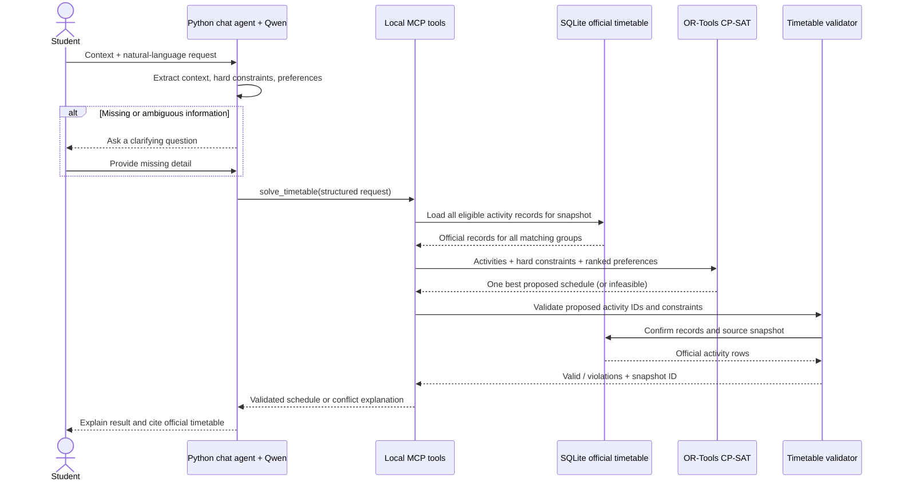
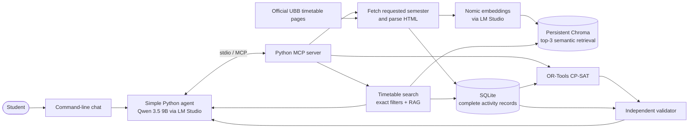

# Milestone 2 — Architecture and Project Plan

> **Status:** Proposed implementation plan
> **Project:** Student Timetable Organizer
> **Related:** [Project RFC](RFC.md)
> **Target:** UBB Cluj, Faculty of Mathematics and Computer Science

## Executive summary

The project is a timetable assistant for students. A student selects their specialization, language, year, semester, group, and subgroup, then describes a timetable question or preference in natural language. The assistant uses the official timetable to answer or proposes a conflict-free personal timetable that respects the student's hard constraints and ranks options by their preferences.

The key flow requested in the teacher's RFC feedback is explicit:

1. Qwen turns natural language into a validated, structured request containing the student's context, hard constraints, and ranked preferences.
2. Python loads the official timetable records for that context and passes the complete eligible activities to the solver.
3. OR-Tools selects a schedule. A separate validator checks every selected activity against the same official timetable snapshot, verifies coverage and conflicts, and rejects any result that cannot be traced to the source data.

RAG helps find relevant timetable records for conversational lookups. The solver and validator use structured SQLite records, so a few retrieved results cannot limit or certify a schedule.

## 1. Problem, scope, and data

### 1.1 Problem

Students currently inspect timetable pages and compare group, seminar, and lab options manually. The number of combinations grows quickly. A student may also have preferences such as avoiding early classes or keeping a day free, or may be unable to attend a particular group's lab because a teacher has refused the change.

The assistant handles timetable questions and personal timetable organization. It does not answer questions about course subject matter, prerequisites, or course descriptions.

### 1.2 Supported student context

Each request uses one academic year and semester. The student supplies, or the assistant asks for:

- specialization;
- teaching language;
- study year (three or four, depending on the specialization);
- current group and subgroup, where applicable;
- requested academic year and semester.

The published timetable for the student's group is the starting schedule. Lectures stay with that group in the first version. Changing seminar and lab groups is a core feature. A proposed group alternative does not imply that the teacher has approved attendance. The student can report a refused alternative, which is excluded from later schedules.

### 1.3 Official data source

Use UBB's official Faculty of Mathematics and Computer Science timetable pages. The URL identifies the academic year and semester; for example:

- [2026–2027, semester I](https://www.cs.ubbcluj.ro/files/orar/2026-1/)
- [2025–2026, semester I](https://www.cs.ubbcluj.ro/files/orar/2025-1/)
- [Tabular timetable index](https://www.cs.ubbcluj.ro/files/orar/2026-1/tabelar/index.html)
- [Example student timetable](https://www.cs.ubbcluj.ro/files/orar/2025-1/tabelar/I1.html)

The team reports official timetables are available from 2014. The app fetches only the semester the student requests; it does not download old semesters automatically. It fetches the pages for all groups and subgroups within the requested specialization, language, and year so the solver can find legitimate timetable alternatives.

The first version parses the official HTML pages only. It does not add PDF or spreadsheet adapters. The inspected table includes day, time, frequency, room, formation (cohort/group/subgroup), activity type, discipline, and teacher. Preserve the frequency label exactly as published. Confirm the meaning of `sapt. 1` and `sapt. 2` before mapping them to odd/even weeks.

### 1.4 Fetch, parse, and cache

`fetch_timetable(academic_year, semester, specialization, teaching_language, study_year, refresh)` constructs the official UBB URL from the requested year and semester; the model does not invent arbitrary URLs. The remaining arguments select which specialization, language, and year of timetable pages to parse. The fetch process:

1. Opens the official semester index and follows links for the requested specialization, language, and study year.
2. Parses the HTML timetable rows into complete activity records.
3. Checks required fields, valid time ranges, recognized activity types, and duplicate records.
4. Stores the structured records in SQLite, along with the source URL, fetch time, and snapshot identifier.
5. Adds or updates searchable activity text in the persistent Chroma collection.

The local cache is keyed by academic year, semester, specialization, language, and study year. A refresh replaces the active cached data only after the new data parses successfully. If fetching fails, the assistant reports the failure and the cached snapshot's fetch time before using cached data. A historical semester is loaded only after a student requests it.

Each record stores at least:

```text
activity_id, academic_year, semester, specialization, teaching_language, study_year,
course_name, activity_type, group, subgroup, day, start_time, end_time,
room, teacher, frequency_label, source_url, fetched_at, snapshot_id
```

One record represents one complete scheduled activity. Keep group and subgroup on the record so the solver can compare alternatives without joining together partial text fragments.

## 2. From natural language to a checked schedule

This section directly addresses the teacher's request to show how preferences become solver inputs and how results are checked against the official schedule.

### 2.1 Convert the request to a structured form

The Python agent provides the current chat and available timetable context to Qwen. Qwen returns a structured request, not a timetable. Python validates the fields before calling any tool. If the student context is missing, or it is unclear whether a statement is a requirement or a preference, the assistant asks a question first.

Example student request:

> “Keep Friday free, avoid classes before 10, and don’t use group 214’s databases lab. I’m in Romanian Computer Science, year 1, group 211.”

Example structured solver input:

```json
{
  "context": {
    "academic_year": "2026-2027",
    "semester": 1,
    "specialization": "Computer Science",
    "teaching_language": "Romanian",
    "study_year": 1,
    "group": "211"
  },
  "hard_constraints": [
    {"type": "free_day", "day": "Friday"},
    {
      "type": "refused_alternative",
      "course": "Databases",
      "activity_type": "Laborator",
      "group": "214"
    }
  ],
  "preferences": [
    {"type": "not_before", "time": "10:00", "priority": 1}
  ]
}
```

“I cannot attend Friday” is a hard constraint. “I would prefer Friday free” is a preference that can be traded off. The assistant must ask if that distinction is unclear. A student-reported teacher refusal is a hard exclusion for that specific alternative in the selected semester.

### 2.2 Solve against official records

The `solve_timetable` tool reads every eligible activity from SQLite for the student's selected context. It starts from the student's published group schedule, keeps lectures fixed, and allows a compatible seminar/lab alternative within the same specialization, language, and year.

OR-Tools CP-SAT applies these hard constraints:

- every required activity from the starting timetable remains covered;
- a selected alternative must exist in the official records for the selected snapshot;
- lectures remain in the student's starting group;
- seminar/lab alternatives remain within the student's specialization, language, and year;
- no two selected activities overlap in time when their week patterns coincide;
- unavailable periods and teacher-refused alternatives are not selected.

For schedules that meet every hard constraint, the solver ranks the student's stated preferences, such as fewer campus days, avoiding early starts, shorter gaps, or keeping a day free. When preference priorities are unclear and they conflict, ask which matters more. Minimize group changes when schedules otherwise rank equally. Return one best schedule in the first version.

If no valid schedule exists, explain that the hard constraints conflict and ask what the student can change. Never silently drop an activity or relax a hard constraint.

### 2.3 Validate against the official timetable

The separate `validate_timetable` tool receives the proposed schedule and its snapshot identifier. It loads the referenced activity IDs from SQLite and checks:

1. Every proposed class, time, room, group, and teacher matches a record in that official snapshot.
2. Every required activity is represented and no invented activity appears.
3. Each chosen seminar/lab is allowed by the student's group context and has not been refused.
4. Lectures remain fixed to the starting group.
5. No scheduled meetings overlap, including the verified week pattern.
6. The result respects every hard constraint.

The validator returns `valid` plus any violations and the snapshot ID. The agent presents a schedule only when validation succeeds. If validation fails, the assistant reports that it could not verify the result; it does not present the invalid schedule as correct. Preferences affect ranking but do not determine validity.

### 2.4 End-to-end sequence



## 3. Architecture at a glance



The RAG search path helps answer natural-language timetable lookups. Exact structured filters return every match for requests such as a full day or a particular group. Schedule generation always reads the complete eligible activity set from SQLite; it never builds a schedule from only the three nearest Chroma results.

## 4. Golden dataset

Create **40 manually reviewed timetable scenarios** from a recorded timetable snapshot:

- 10 development scenarios for refining parsing, prompts, and retrieval settings;
- 30 held-out scenarios for final evaluation;
- a second teammate reviews each scenario before it enters the set.

Include direct timetable lookups, hard and soft preference extraction, seminar/lab switching, refused alternatives, unavailable periods, alternating-week activities, missing student context, nonexistent activities, and impossible requests.

Each scenario records the student context, natural-language request, expected structured constraints, expected source activities, expected tool behavior, and whether a valid schedule exists. For scheduling cases, accept any schedule that satisfies the expected constraints and official records; do not require one exact arrangement if several are valid. Keep the held-out 30 separate from prompt and retrieval tuning.

## 5. RAG design

### 5.1 What is retrieved

The retrieval unit is one complete official timetable activity, including its activity type, course name, group/subgroup, time, room, teacher, frequency label, selected semester, and source metadata. Do not split an activity into arbitrary 90-word pieces. The 90-word chunk size and 15-word overlap in the Week 5–6 lab are for prose documents; a timetable activity is already a compact, meaningful record.

### 5.2 Models, storage, and comparisons

- **Embedding model:** `text-embedding-nomic-embed-text-v1.5`, served locally through LM Studio, following the Week 5–6 lab.
- **Vector store:** persistent local Chroma, following the same lab.
- **Retrieval count:** top 3 semantic matches, filtered by academic year, semester, specialization, language, and study year; apply group filters when the question specifies a group.
- **Keyword baseline:** the lab's TF-IDF lexical retriever.
- **Default answer flow:** basic RAG — retrieve timetable evidence, then ask Qwen to answer only from those records and cite them.
- **Comparison flow:** corrective RAG — if retrieved evidence appears insufficient, rewrite the query and retry retrieval once. If evidence still does not support an answer, say the timetable data does not answer it.

Compare TF-IDF with Chroma vector retrieval and basic RAG with the one-retry corrective variant. Use the same questions and timetable snapshot. Corrective RAG is an experiment, not the normal app path; its extra model decision and search are included in the latency and call-count results.

These model and retrieval choices are based on the [Week 5–6 lab README](../../../Labs/Week5-6/lab03_rag/README.md), [instructor notes](../../../Labs/Week5-6/lab03_rag/INSTRUCTOR.md), and notebook. The record-level chunking and use of SQLite as the solver's complete source are project-specific adaptations.

### 5.3 Evidence and citations

Every answer about a scheduled activity includes its official timetable page, selected academic year and semester, group, and fetch/snapshot time. RAG-generated text is never itself evidence; cited details must match retrieved official records. For incomplete or conflicting records, explain the gap and ask for clarification or report that the timetable cannot answer. Do not infer missing times, groups, or permissions.

## 6. Agent and MCP tools

### 6.1 Agent responsibilities

Qwen handles natural-language interpretation and explanation. The Python agent:

1. checks that student context is complete;
2. asks about unclear wording or whether a constraint is hard or flexible;
3. validates Qwen's structured output;
4. calls the relevant MCP tool;
5. presents search results only with their timetable evidence;
6. presents a proposed schedule only after validation succeeds.

The first version uses a simple Python request/tool loop and command-line chat. It does not use LangGraph or save long-term student profiles. Context and refusals persist only during the current chat.

### 6.2 MCP tool contracts

The local Python MCP server uses stdio. Tool inputs and outputs are structured and validated before Python reads or changes local data.

| Tool | Input | Output | Purpose |
|---|---|---|---|
| `fetch_timetable` | `academic_year`, `semester`, `specialization`, `teaching_language`, `study_year`, optional `refresh` | source URL, fetch time, snapshot ID, record count, cache/error status | Load the requested semester and all groups in the selected student context. |
| `search_timetable` | question, student context, optional exact filters | up to 3 semantic records or all exact filter matches, each with citation metadata | Answer a timetable lookup with evidence. |
| `solve_timetable` | context, hard constraints, ranked preferences, refused alternatives | one best proposed schedule, preference score, snapshot ID, or infeasibility details | Turn interpreted preferences into a solver result. |
| `validate_timetable` | proposed activity IDs, context, snapshot ID | validity, violations, and verified snapshot ID | Check that the proposed result matches the official timetable. |

The solver uses SQLite directly to load every eligible activity. RAG's top-three limit applies only to semantic question answering, not to schedule construction or validation.

## 7. Model choices

| Role | Choice | Reason |
|---|---|---|
| Language and tool-selection model | **Qwen 3.5 9B**, run locally through LM Studio | It was the first model downloaded in the first laboratory, and every team member already has it. This gives the team a shared starting point without requiring another chat-model download. |
| Timetable embeddings | **Nomic `text-embedding-nomic-embed-text-v1.5`**, through LM Studio | This is the embedding model used in the Week 5–6 lab, so the team can follow the demonstrated workflow. |

The model choice is practical rather than a claim that Qwen is already best for this task. Measure constraint extraction, tool selection, grounded answers, and latency on the golden scenarios. The solver and validator provide schedule correctness; the language model does not create or certify timetable facts.

## 8. Experiments and evaluation

| Experiment | Method | Measures |
|---|---|---|
| Timetable parsing | Compare parsed records with sampled official pages across selected programs/groups. | Required-field coverage, time validity, group/activity correctness, and frequency-label preservation. |
| Retrieval | Run the same timetable questions against TF-IDF and Chroma vector retrieval. | Hit@3 for the expected official activity; inspect exact-filter completeness separately. |
| RAG approach | Run basic and one-retry corrective RAG on the same questions and evidence snapshot. | Correct answer, source support, unsupported claims, model calls, and latency. |
| Natural-language interpretation | Compare Qwen's structured constraints with reviewed expected constraints. | Per-field accuracy and precision/recall for hard constraints, preferences, group refusals, and context. |
| Solver and validation | Run schedule requests against official activity records, including conflicting cases. | 100% of presented schedules pass independent validation; required activity coverage; hard-constraint violations; preference score. |
| End-to-end behavior | Run held-out conversational requests through the CLI and MCP tools. | Correct clarification/rejection, tool choice/arguments, evidence citation, valid schedule, and elapsed time. |

Run experiments first on the 10 development scenarios. Freeze the selected prompts and settings before running the 30 held-out scenarios. Do not tune on the held-out results. Store the question set version, timetable snapshot, model IDs, retrieval settings, outputs, and metrics so results can be reproduced.

## 9. Week-by-week plan through Week 14

This plan uses the dates in the existing architecture-plan scaffold, beginning with Week 7 and ending with the Week 14 progress presentation.

| Week | Dates | Deliverables | Experiment/check |
|---|---|---|---|
| **7** | 9–13 Nov 2026 | Confirm the activity schema; build the UBB URL builder and HTML fetch prototype; inspect one specialization/language/year across its groups. | Manually compare parsed rows with official pages; record unresolved week-label meanings. |
| **8** | 16–20 Nov | Complete HTML parser, SQLite cache, explicit refresh, snapshot/source metadata, and parse validation. | Check required-field coverage and compare records from several groups/subgroups with the source. |
| **9** | 23–27 Nov | Generate searchable text for complete activity records; set up Nomic through LM Studio and persistent Chroma; add TF-IDF baseline. | Measure development-set Hit@3 for TF-IDF and vector retrieval. |
| **10** | 30 Nov–4 Dec | Implement the four MCP tools, command-line chat loop, structured request schema, OR-Tools constraints, and independent validator. | Verify conflict handling, fixed lectures, seminar/lab alternatives, refusal exclusions, and validation against SQLite. |
| **11** | 7–11 Dec | Integrate Qwen 3.5 9B with MCP; add clarifying questions and evidence citations; finish the 40 reviewed scenarios and 10/30 split. | Check natural-language-to-constraint conversion on development cases. |
| **12** | 14–18 Dec | Finish basic RAG and the bounded corrective experiment; freeze the app path and experiment settings. | Compare retrieval and RAG variants on the development set; fix errors without using held-out answers. |
| **Break** | 21 Dec 2026–3 Jan 2027 | No required feature work; retain as schedule buffer. | — |
| **13** | 4–8 Jan 2027 | Run the frozen system on the 30 held-out scenarios; analyze errors and prepare results. | Final held-out validity, constraint, retrieval, citation, and latency measurements. Do not tune on these results. |
| **14** | 11–15 Jan 2027 | Prepare and deliver the progress presentation; finish diagrams, reproducibility notes, and documentation. | Present architecture, measured results, limitations, and next steps. |

## 10. Risks and limits

| Risk | Handling |
|---|---|
| UBB changes timetable HTML | Keep the parser limited to known official pages, validate required fields, and report parsing errors instead of silently accepting partial data. |
| Timetable cache is stale | Show source URL, semester, snapshot, and fetch time; allow explicit refresh and identify cache fallback. |
| `sapt. 1` / `sapt. 2` meaning is unclear | Preserve the published label and confirm the convention before treating it as odd/even weeks for conflict checks. |
| RAG misses a relevant activity | Measure Hit@3; use exact structured filters for complete listings; use all SQLite records for solving. |
| Qwen misreads a hard constraint or tool argument | Validate structured output, ask about ambiguity, and independently validate every schedule. |
| Another teacher may reject a suggested group | Describe it as a timetable alternative, not permission; allow a specific refusal to be recorded. |
| No feasible schedule exists | Explain the conflicting hard constraints and ask what the student can change; never relax them silently. |
| Course information is absent | Course-content questions and prerequisite reasoning are out of scope. |

## Out of scope for the first version

- Calendar export (possible later addition).
- Course descriptions, prerequisite checks, and course recommendations.
- PDF or spreadsheet timetable parsing.
- Automatic timetable monitoring or automatic fetching of historical semesters.
- LangGraph, hosted vector databases, multi-agent flows, and long-term student profiles.
