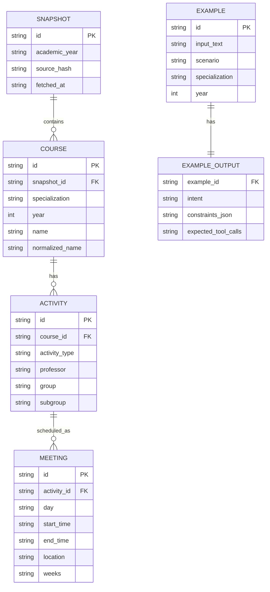
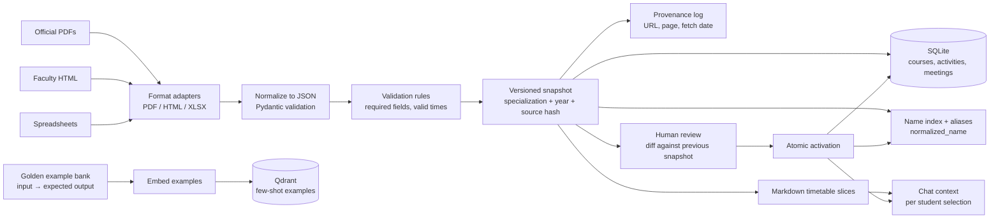
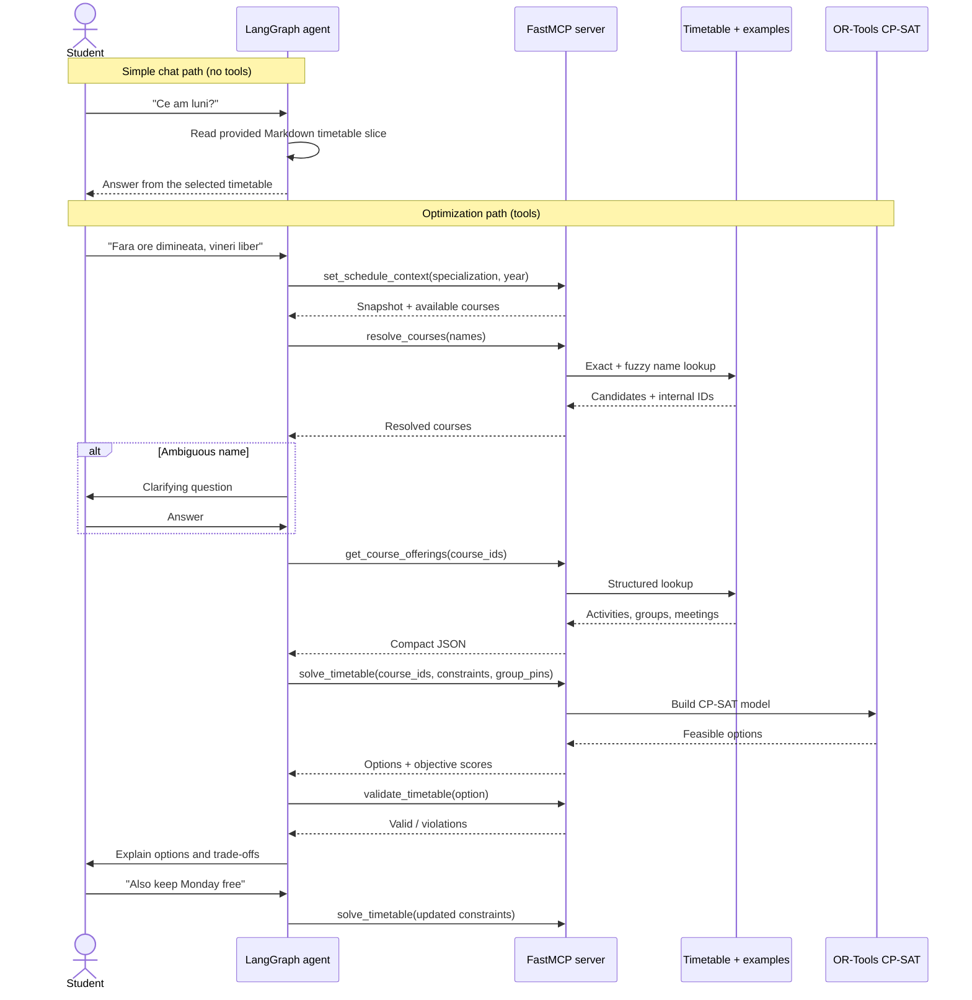
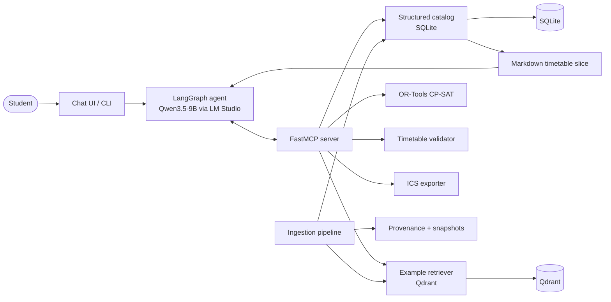
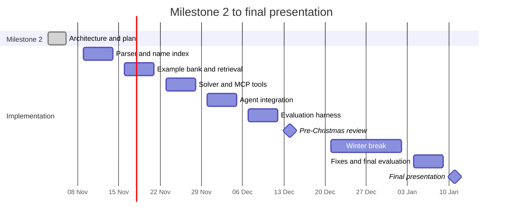

# Milestone 2 — Architecture and Project Plan

> **Status:** Draft for team review  
> **Project:** Student Timetable Organizer  
> **Related:** [RFC](./RFC.md)  
> **Review branch:** `docs/milestone2-architecture-plan`

## Executive summary

The system is a conversational timetable assistant. The student says which subjects they take and what they prefer, and the system produces valid, conflict-free timetable options from the official timetable of their specialization and year.

The design deliberately separates two responsibilities:

1. **The LLM understands and explains.** It parses the request, asks clarifying questions, chooses tools, and explains the result.
2. **The solver guarantees correctness.** A constraint solver chooses the groups and builds the actual timetable. The LLM never invents course times or rooms.

The input data is one official timetable per **specialization + year**, containing all groups. Course names are unique within that context, so the system does not need official course codes. Schedule data is stored as structured JSON; the LLM receives only compact tool results or a Markdown slice of the student's timetable. RAG is used for **retrieved few-shot examples** (input → expected tool call/constraints), not for schedule facts.

---

## 1. Problem and data

### 1.1 Task

**Input:** a student request in natural language, for example:

> "I am in Computer Science, second year. I take Algorithms and Mathematical Analysis. No classes before 10:00, and Friday free. Keep my group for the Analysis lab."

**Output:** one or more valid timetable options containing:

- every selected course;
- one valid activity/group choice per course;
- zero time overlaps;
- the student's pinned group respected where requested;
- a preference score and a short explanation;
- optional `.ics` calendar export.

The system must support follow-up requests such as "also keep Monday free" without starting over.

### 1.2 Data sources and scope

The primary source is the **official timetable** supplied by the team, in PDF, HTML, or spreadsheet form. The timetable is organized by **specialization and year**, and includes all groups for that specialization/year.

The available fields are:

- course name;
- professor;
- activity type: course, lab, seminar, or project;
- group and subgroup;
- day;
- start time and end time;
- location.

There are **no official course codes**, **no course descriptions**, **no prerequisite data**, and **no regulation documents** in the current dataset.

A small synthetic fixture is checked into the repository for deterministic tests and CI. Real timetable snapshots are versioned and kept in `data/raw/<academic_year>/`.

**Scope limitation:** because prerequisite data is missing, the system does not validate prerequisites in v1. It only builds a conflict-free timetable from the courses the student names.

### 1.3 Course identity without official codes

Course names are unique within the same **specialization + year**. The internal key is therefore:

```text
(specialization, year, normalized_name)
```

Example:

```text
(Computer Science, 2, mathematical-analysis)
```

`normalized_name` is produced by lowercasing, removing diacritics, collapsing whitespace, and removing punctuation. The original `name` is kept for display.

If the same name appears in different years or specializations, the context filters it out. If a name is still ambiguous after filtering, the agent asks a clarifying question instead of guessing.

### 1.4 How the timetable is given to the AI: JSON and Markdown, never raw HTML

**Decision:** HTML and PDF are only ingestion formats. After parsing, all schedule data is normalized into a compact JSON model. From the same model we generate a Markdown view.

| Use case | Representation | Tools? |
|---|---|---|
| Simple questions about the student's timetable ("Ce am luni?") | Markdown slice, generated from JSON | No |
| Building timetable options | JSON tool results + solver | Yes |
| Name resolution | Structured exact/fuzzy search | Yes |
| Export to calendar | Structured option + `.ics` | Yes |

The fields the project actually needs:

| Field | Meaning | Example |
|---|---|---|
| `specialization` | Study programme | `Computer Science` |
| `year` | Study year | `2` |
| `name` | Course name as printed | `Mathematical Analysis` |
| `normalized_name` | Search key | `mathematical-analysis` |
| `professor` | Teacher for the activity | `Prof. Popescu` |
| `activity_type` | `course`, `lab`, `seminar`, or `project` | `lab` |
| `group` | Group | `2A` |
| `subgroup` | Subgroup, when applicable | `2A-1` |
| `day` | Day of the week | `Monday` |
| `start_time` | Start time | `08:00` |
| `end_time` | End time | `10:00` |
| `location` | Room or building | `A1-203` |

Example tool result:

```json
{
  "course_id": "computer-science__2__mathematical-analysis",
  "specialization": "Computer Science",
  "year": 2,
  "name": "Mathematical Analysis",
  "activities": [
    {
      "activity_id": "computer-science__2__mathematical-analysis__lab__2A-1",
      "professor": "Prof. Popescu",
      "activity_type": "lab",
      "group": "2A",
      "subgroup": "2A-1",
      "meetings": [
        {
          "day": "Monday",
          "start_time": "08:00",
          "end_time": "10:00",
          "location": "A1-203",
          "weeks": "1-14"
        }
      ]
    }
  ]
}
```

Example generated Markdown slice for simple chat:

```markdown
# Timetable — Computer Science, Year 2

## Monday
- **08:00 - 10:00** | Lab: Mathematical Analysis | Group 2A / 2A-1 | Room A1-203 | Prof. Popescu
- **10:00 - 12:00** | Course: Algorithms | Group 2A | Room A2 | Prof. Ionescu

## Tuesday
- **12:00 - 14:00** | Seminar: Linear Algebra | Group 2A | Room C112
```

Why this representation:

- **Low token cost:** Markdown is compact for chat; JSON is compact for tools.
- **Exact filtering:** the solver and tools filter by specialization, year, group, subgroup, type, day, and time.
- **Fewer hallucinations:** there is no raw HTML or full faculty timetable in the prompt.
- **Deterministic validation:** the same JSON is used to check overlaps and coverage.
- **Human review:** Markdown is easy to inspect and compare with the official timetable.
- **HTML stays for audit:** source URL, page number, and snapshot version are stored for provenance.

The LLM is **not** given the whole faculty timetable. For simple chat it receives only the student's selected timetable slice as Markdown. For optimization it calls tools and receives only the matching JSON records.

### 1.5 Normalized data model



### 1.6 Ingestion pipeline



### 1.7 New data ingestion

New timetable files are dropped into `data/inbox/`. The ingestion command:

1. detects the format and selects an adapter;
2. parses into the normalized schema;
3. validates required fields and time ranges;
4. writes a new immutable snapshot with a content hash;
5. diffs the new snapshot against the active one;
6. rebuilds the name index and Markdown views;
7. produces a review report;
8. activates the snapshot atomically only after approval.

Snapshots are never edited in place. A timetable generated from an older snapshot can always be traced back to the exact source version.

### 1.8 Data quality and provenance

Every record stores `source_document`, `source_page`, `source_url`, `snapshot_id`, and `fetched_at`. Validation checks include:

- required fields (`specialization`, `year`, `name`, `activity_type`, `day`, `start_time`, `end_time`);
- `start_time < end_time`;
- no duplicate activity IDs;
- group/subgroup consistency;
- every activity belongs to an existing course;
- course name uniqueness within `(specialization, year)`.

---

## 2. Golden dataset

### 2.1 Size and categories

Target: **80 reviewed examples**, built from a frozen timetable snapshot.

| Category | Count | Purpose |
|---|---:|---|
| Simple requests | 20 | One or two preferences, clearly stated |
| Multi-constraint requests | 15 | Several soft constraints together |
| Course-list requests | 15 | Student names the subjects explicitly |
| Group-pinning requests | 10 | "Keep my group for course X" |
| Ambiguous requests | 8 | Missing specialization/year, typo, or unclear course |
| Impossible / conflicting requests | 7 | No valid timetable; agent must explain |
| Nonexistent course / adversarial | 5 | Agent must reject instead of inventing data |

### 2.2 Example item

```json
{
  "id": "golden-042",
  "prompt": "Sunt la Calculatoare, anul 2. Fac Algoritmi și Analiză Matematică. Vreau fără ore înainte de 10 și vineri liber.",
  "context": {
    "specialization": "Calculatoare",
    "year": 2
  },
  "expected_intent": "build_timetable",
  "expected_constraints": {
    "not_before": "10:00",
    "free_days": ["Friday"]
  },
  "expected_courses": ["Algoritmi", "Analiză Matematică"],
  "expected_behavior": "solve",
  "rubric": {
    "hard_validity": true,
    "all_selected_courses_covered": true,
    "no_overlaps": true,
    "preference_satisfaction": "maximize"
  }
}
```

### 2.3 Example bank vs test set

The golden dataset is split into two disjoint parts:

- **`example_bank`** — used by RAG as retrieved few-shot examples;
- **`test_set`** — used only for evaluation.

No prompt from `test_set` appears in `example_bank`. This avoids leakage and makes the RAG comparison honest.

### 2.4 Construction process

1. Freeze one timetable snapshot.
2. Write prompts from realistic student scenarios, not from the schema.
3. Manually derive the expected constraints, course names, and group pins.
4. Cross-review every item with a second team member.
5. Split into `example_bank` and `test_set`; never tune prompts on `test_set`.
6. Re-run the dataset when the timetable snapshot changes, and record the new snapshot ID.

### 2.5 Metrics

- **Hard validity:** 100% of returned timetables have no overlaps, cover all selected courses, and use real activities/groups.
- **Name resolution:** accuracy of mapping names from chat to timetable entries.
- **Constraint extraction:** precision, recall, and F1 against the expected structured constraints.
- **Tool correctness:** correct tool selected, valid arguments, correct order.
- **Group-pinning accuracy:** pinned courses use exactly the requested group.
- **Preference satisfaction:** weighted soft-constraint score.
- **Behaviour accuracy:** correct answer / clarification / rejection.
- **Latency:** end-to-end time per request.

---

## 3. RAG design: retrieved few-shot examples

### 3.1 What uses RAG and what does not

| Data | Access method | Reason |
|---|---|---|
| Days, times, rooms, groups, professors | Structured SQL tools | Exact lookup and filtering |
| Course names | Exact/fuzzy structured search | Names are unique in context |
| Interaction examples | RAG over input → output pairs | Helps the LLM format requests and choose tools |
| Schedule facts | Never from RAG | Must come from the structured snapshot |

**Key decision:** RAG is not used to invent or reconstruct schedules. If a course is missing from the structured snapshot, the system treats it as unknown even if a similar example exists in the vector index.

### 3.2 Corpus and chunking

- **One example per chunk.** Each chunk contains the student input and the expected assistant behaviour.
- Expected output contains the intent, structured constraints, and expected tool calls — **not** a full timetable to copy.
- Metadata: `scenario`, `specialization`, `year`, `difficulty`, `split=example_bank`.
- No overlap between chunks; examples are already atomic.
- Romanian and English variants of the same scenario are separate examples.

Example chunk:

```json
{
  "input": "Vreau fără ore dimineața și vineri liber",
  "output": {
    "intent": "solve_timetable",
    "constraints": {
      "not_before": "10:00",
      "free_days": ["Friday"]
    }
  }
}
```

### 3.3 Embeddings and vector database

- Baseline embedding model: **`nomic-embed-text-v1.5`**, already available in LM Studio.
- Candidate multilingual model: **`bge-m3`**, compared only if time allows (E3).
- Vector database: **Qdrant**, persistent local instance, with metadata filters for specialization and year.
- Retrieval: top-3 examples, filtered by specialization/year when that context is known.

Rationale: Qdrant supports metadata filtering, local deployment, and a simple Python client. It keeps the project reproducible without a managed cloud dependency.

### 3.4 Variants to compare

| Variant | Description | Role |
|---|---|---|
| A. No examples | Plain prompt, no few-shot | Baseline |
| B. Static few-shot | Fixed set of 3 examples | Simple baseline |
| C. Retrieved few-shot | Top-3 similar examples from Qdrant | **Main variant** |
| D. Retrieved + metadata filter | Top-3 filtered by specialization/year | Optional refinement |

**Lean experiment plan:** implement variant C as the main path, and run the same pipeline with A and B as baselines. Variant D is optional.

### 3.5 Retrieval evaluation

- constraint extraction F1;
- tool-call accuracy;
- output-format validity;
- hard-validity of the final timetable;
- token count and latency;
- error analysis by scenario type.

---

## 4. Agent, tools, and MCP server

### 4.1 Decisions the agent makes

1. Which specialization and year is the student in?
2. Which course names did the student mention, and do they resolve exactly?
3. Is a clarifying question needed for an ambiguous name?
4. Does the student want any group, or a specific group for a specific course?
5. Are the constraints hard or soft?
6. Does the solver result satisfy the request, or should the agent explain a conflict?
7. Should the result be exported to a calendar?

The agent is implemented as a **LangGraph** state machine. It is not allowed to answer schedule questions from model memory.

### 4.2 Tool catalogue

| Tool | Input | Output | Purpose |
|---|---|---|---|
| `set_schedule_context` | specialization, year | snapshot ID + available course names | Load the correct timetable |
| `resolve_courses` | list of names | candidates + internal IDs + confidence | Map chat names to timetable entries |
| `get_course_offerings` | course ID | activities, groups, meetings | Fetch groups/times/rooms |
| `solve_timetable` | course IDs, constraints, group pins | timetable options | Run CP-SAT optimization |
| `validate_timetable` | timetable option | violations + score | Independent correctness check |
| `export_ics` | timetable option | `.ics` content | Calendar export |

Each tool has a JSON schema, typed inputs, typed outputs, and explicit error codes. Invalid arguments are rejected by the MCP server before execution.

### 4.3 MCP exposure

The tools are exposed through a **FastMCP** server:

- local development over `stdio`;
- demo over streamable HTTP;
- read-only timetable tools by default;
- session state is kept by the agent, not written into the catalog;
- every tool returns the snapshot version used.

The LangGraph agent connects to the MCP server as a client. The MCP server is the single source of truth for tool behaviour, so the same tools can later be used from LM Studio, a CLI, or another client.

### 4.4 Solver model

**Hard constraints:**

- one activity choice per selected course;
- no overlapping meetings;
- only real activities from the selected timetable snapshot;
- if `group_pins[course]` is set, the chosen activity must use that group;
- if the student pins "my group", the group must be known or asked for.

**Soft preferences (weighted objective):**

- minimize number of campus days;
- minimize idle gaps;
- avoid classes before a requested time;
- keep requested days free;
- prefer certain professors or activity types.

The solver is **OR-Tools CP-SAT**. If no feasible timetable exists, it returns a minimal conflict explanation (for example, "Algorithms lab and Mathematical Analysis seminar overlap for every group combination").

**Out of scope:** prerequisite validation and optional-course recommendation by description, because the dataset does not contain those fields.

### 4.5 Validation and safety

- The solver output is re-checked by an independent validator.
- The agent may only cite courses and times returned by tools.
- A request for a nonexistent course is rejected with a clear message.
- The LLM cannot modify timetable data.
- Every final answer includes the snapshot ID used.

### 4.6 Interaction paths



---

## 5. Model choices

| Role | Model | Rationale |
|---|---|---|
| Agent / tool calling | **Qwen3.5-9B Q4_K_M** via LM Studio | Already installed; local; multilingual; supports tool calling; good quality/size trade-off |
| Embeddings (baseline) | **nomic-embed-text-v1.5** via LM Studio | Already installed; fast local baseline |
| Embeddings (multilingual candidate) | **bge-m3** | Optional comparison if Romanian example retrieval is weak |
| Baselines | smaller local model + hosted model | Optional comparison for tool-calling reliability |

The local setup avoids sending university documents to a third party and keeps the demo reproducible. The model is accessed through LM Studio's OpenAI-compatible API, so the agent code is not tied to a specific runtime.

Selection checks will compare:

- tool-call success rate;
- constraint extraction F1;
- output-format validity;
- latency and memory use;
- behaviour on ambiguous and adversarial requests.

---

## 6. Architecture at a glance



### Key architecture decisions

| Decision | Choice | Rationale | Alternatives |
|---|---|---|---|
| Representation given to AI | JSON for tools + generated Markdown for chat | Fewer tokens, exact filtering, readable chat context | Raw HTML, full timetable in prompt |
| Course identity | `(specialization, year, normalized_name)` | No official codes; names unique in context | External course codes |
| Schedule correctness | Deterministic solver | Guarantees valid timetables | Let the LLM generate times |
| RAG | Retrieved few-shot examples | No descriptions/rules exist; examples help formatting | RAG over course descriptions |
| Vector DB | Qdrant | Local, metadata filters, simple Python client | Chroma, FAISS, pgvector |
| Tool interface | FastMCP | Standard interface, reusable clients | Custom REST API only |
| Agent orchestration | LangGraph | Explicit state machine and retries | Free-form agent loop |
| Storage | SQLite | Simple, portable, easy to test | PostgreSQL |
| Calendar export | `.ics` | Works with common calendar apps | Proprietary formats |

---

## 7. Experiments and evaluation

Lean plan: one implementation with configurable example mode, not three separate systems.

| ID | Experiment | Method | Success criterion | Week |
|---|---|---|---|---|
| E1 | Examples ablation | Run same pipeline with `examples=none`, `static`, `retrieved` | Retrieved or static improves constraint F1 / tool-call accuracy without unacceptable token cost | 8–11 |
| E2 | End-to-end validity | Run chosen variant on `test_set` | 100% hard-valid timetables; high preference score; correct clarify/reject behaviour | 11–13 |
| E3 | Embedding check (optional) | `nomic-embed-text-v1.5` vs `bge-m3` on example retrieval | Best recall@3 on Romanian queries | 11–13 |

Evaluation harness: Python + `pytest`, custom metrics, and a JSON results file. Results are summarized in `docs/EVALUATION.md`.

---

## 8. Plan: Week 6 to Week 14

**Assumptions:** small student team; one shared repository; the official timetable files arrive during Week 6–7. Week 12 is the pre-Christmas review; the winter break is buffer only.

| Week | Dates | Deliverables | Experiments / checks |
|---|---|---|---|
| **6** | 3–6 Nov 2026 | Milestone 2 document, branch, repo skeleton, normalized schema, synthetic fixture, MCP skeleton | Internal review of architecture |
| **7** | 9–13 Nov | PDF/HTML timetable adapters, SQLite catalog, name index, Markdown generator, provenance, golden dataset v0 | Parser and name-index checks |
| **8** | 16–20 Nov | Example bank, Qdrant indexing, retrieval harness, `resolve_courses` | E1 start: none vs static vs retrieved |
| **9** | 23–27 Nov | CP-SAT solver, validator, group pins, MCP tool contracts, golden dataset v1 | Solver feasibility, overlap and group-pin checks |
| **10** | 30 Nov–4 Dec | LangGraph agent, chat path, optimization path, `.ics` export | End-to-end prototype |
| **11** | 7–11 Dec | Evaluation harness, error analysis, robustness tests | E1 and E2 first full run |
| **12** | 14–18 Dec | **Pre-Christmas review:** freeze MVP, golden dataset v1, evaluation report v1, demo, documented commits | E1/E2 results |
| — | 21 Dec–1 Jan | Winter break; no committed feature work, optional buffer | — |
| **13** | 4–8 Jan 2027 | Feedback fixes, optional E3, final evaluation, final diagrams, presentation draft | Final E1/E2, optional E3 |
| **14** | 11–15 Jan 2027 | Final presentation, reproducibility cleanup, final docs, tagged release | Final metrics table |



### Weekly commit expectations

- Commit at least 3–4 times per implementation week with focused messages.
- Keep experiments reproducible: config, seed, model name, and timetable snapshot in every result file.
- Update `docs/EVALUATION.md` weekly with the latest numbers.
- Before Week 12, the repository must contain a runnable MVP, the golden dataset, and the evaluation report.

---

## 9. Risks and limitations

| Risk | Impact | Mitigation |
|---|---|---|
| No official course codes | Harder matching | Internal IDs from `(specialization, year, normalized_name)` |
| Name typos, diacritics, abbreviations | Course not found or wrong match | Normalization, aliases, fuzzy matching, clarification |
| Duplicate names across years/specializations | Wrong context | Ask for specialization/year and filter before matching |
| No prerequisite data | Cannot validate eligibility | Declare prerequisites out of scope for v1 |
| No course descriptions | Cannot recommend optionals by interest | Student names courses; search only by name/professor/type |
| Group pin conflicts | No feasible timetable | Explain the conflict and suggest relaxing the pin |
| PDF layout varies between documents | Wrong parsed fields | Format adapters, validation, human review, snapshot diff |
| Retrieved examples from wrong context | Misleading few-shot prompt | Metadata filters and separate example/test splits |
| LLM calls tools with wrong arguments | Broken flow | JSON-schema validation, retries, deterministic fallback |
| Solver has no feasible solution | User confusion | Return minimal conflict explanation and alternatives |
| Model too slow locally | Poor demo | Quantized model, limited context, cached retrieval |
| Timeline slips | Missed Week 12 review | Freeze MVP in Week 12, use winter break as buffer |
| Raw data cannot be published | Repository problems | Commit only synthetic fixtures; keep real timetables local or ignored |

---

## 10. Open questions for team review

1. Are the timetable and student requests mainly **Romanian, English, or both**?
2. Can the real timetable files be committed to the repository, or must they stay local?
3. Do we need a web UI for the final demo, or is a CLI plus chat transcript enough?
4. Who owns ingestion, solver, agent, and evaluation? The timeline assumes parallel work.
5. Should the chat remember a student's specialization/year between sessions, or ask every time?

---

## Appendix A — Example normalized activity record

```json
{
  "course_id": "computer-science__2__mathematical-analysis",
  "specialization": "Computer Science",
  "year": 2,
  "name": "Mathematical Analysis",
  "normalized_name": "mathematical-analysis",
  "activity_id": "computer-science__2__mathematical-analysis__lab__2A-1",
  "professor": "Prof. Popescu",
  "activity_type": "lab",
  "group": "2A",
  "subgroup": "2A-1",
  "day": "Monday",
  "start_time": "08:00",
  "end_time": "10:00",
  "location": "A1-203",
  "weeks": "1-14",
  "snapshot_id": "2026-2027-1",
  "source_document": "timetable-2026.pdf",
  "source_page": 14
}
```

## Appendix B — Example MCP tool schema

```json
{
  "name": "solve_timetable",
  "description": "Build valid timetable options from selected courses and constraints.",
  "input_schema": {
    "type": "object",
    "required": ["course_ids", "constraints", "snapshot_id"],
    "properties": {
      "course_ids": {"type": "array", "items": {"type": "string"}},
      "constraints": {
        "type": "object",
        "properties": {
          "not_before": {"type": "string"},
          "free_days": {"type": "array", "items": {"type": "string"}},
          "avoid_gaps": {"type": "boolean"},
          "max_campus_days": {"type": "integer"}
        }
      },
      "group_pins": {
        "type": "object",
        "additionalProperties": {"type": "string"}
      },
      "snapshot_id": {"type": "string"}
    }
  }
}
```

## Appendix C — Example retrieved few-shot pair

```json
{
  "input": "Sunt la Calculatoare, anul 2. Vreau fără ore înainte de 10 și vineri liber.",
  "output": {
    "intent": "solve_timetable",
    "context": {
      "specialization": "Calculatoare",
      "year": 2
    },
    "constraints": {
      "not_before": "10:00",
      "free_days": ["Friday"]
    }
  }
}
```

## Appendix D — Example user flow

1. Student: "Sunt la Calculatoare, anul 2. Fac Algoritmi și Analiză Matematică."
2. Agent sets the context and resolves both names.
3. Student: "Fără ore înainte de 10 și vineri liber."
4. Agent extracts constraints.
5. Student: "La Analiză vreau să rămân la grupa mea."
6. Agent asks for the group if it is not known, then stores a group pin.
7. Agent calls `solve_timetable`.
8. Solver returns two valid options.
9. Agent calls `validate_timetable` for each option.
10. Agent explains the trade-offs and offers `.ics` export.
11. Student: "Mai vreau și luni liber." The loop repeats with the updated constraint.
