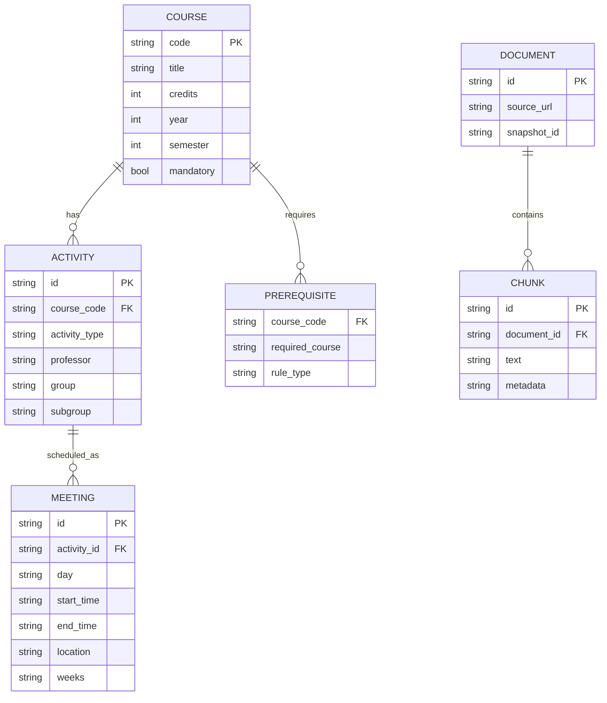
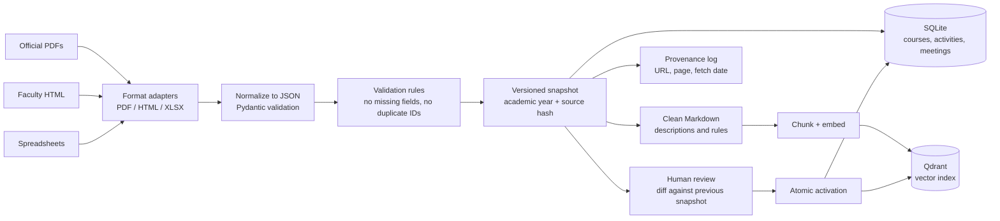
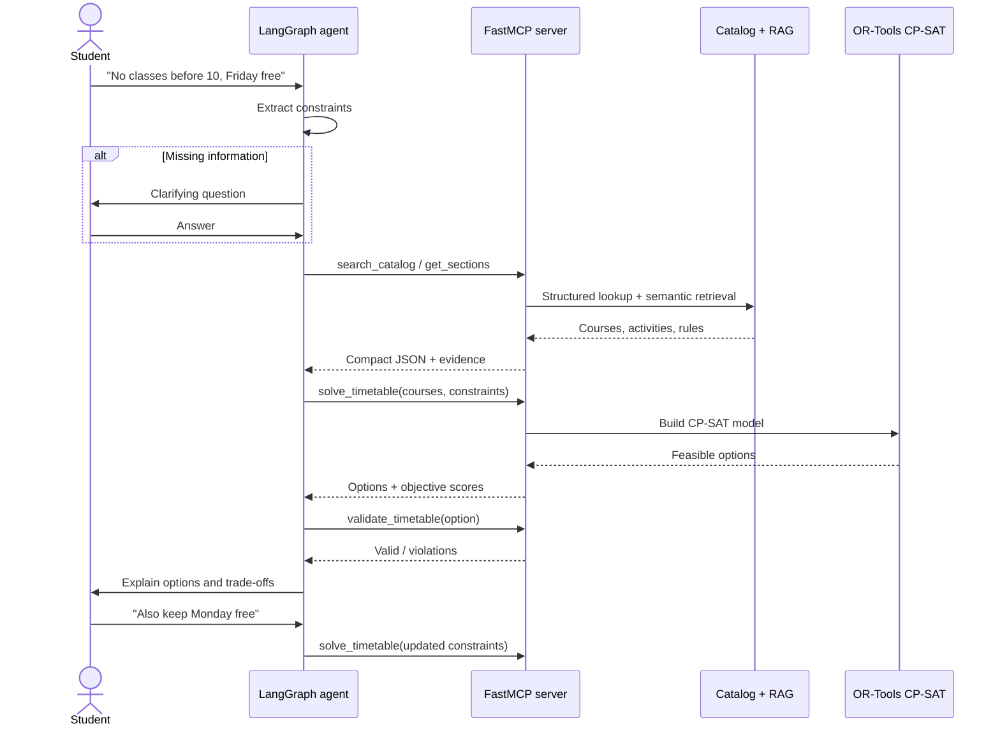
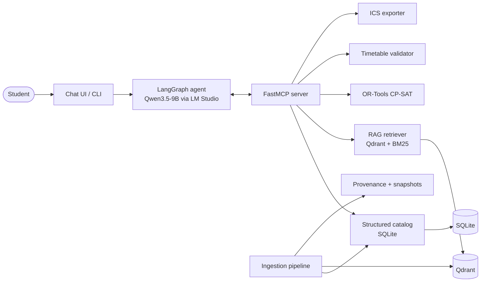
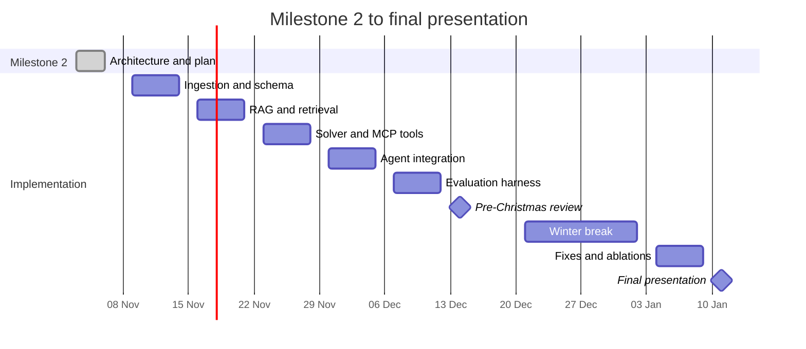

# Milestone 2 — Architecture and Project Plan

> **Status:** Draft for team review  
> **Project:** Student Timetable Organizer  
> **Related:** [RFC](./RFC.md)  
> **Review branch:** `docs/milestone2-architecture-plan`

## Executive summary

The system is a conversational timetable assistant. The student describes what they want in natural language, and the system produces valid, conflict-free timetable options from official university data.

The design deliberately separates two responsibilities:

1. **The LLM understands and explains.** It parses the request, asks clarifying questions, chooses tools, and explains the result.
2. **The solver guarantees correctness.** A constraint solver builds the actual timetable. The LLM never invents course times or rooms.

Official catalogs are parsed into a normalized JSON/SQL database. The LLM receives compact tool results — not raw HTML — and the solver receives structured constraints. RAG is used only for unstructured text such as course descriptions and regulation prose.

---

## 1. Problem and data

### 1.1 Task

**Input:** a student request in natural language, for example:

> "I want all mandatory courses, no classes before 10:00, and Friday free."

**Output:** one or more valid timetable options containing:

- every selected course;
- one valid activity/group choice per course;
- zero time overlaps;
- satisfied prerequisites;
- a preference score and a short explanation;
- optional `.ics` calendar export.

The system must support follow-up requests such as "also keep Monday free" without starting over.

### 1.2 Data sources

The primary source is the **official faculty catalog and schedule** supplied by the team, in PDF, HTML, or spreadsheet form. This includes:

- curriculum by year and semester;
- course descriptions;
- course/lab/seminar groups and subgroups;
- professors, rooms, days, and times;
- prerequisite rules;
- academic calendar and week ranges.

A small synthetic fixture is checked into the repository for deterministic tests and CI. Real catalog snapshots are versioned and kept in `data/raw/<academic_year>/`.

### 1.3 How the timetable is given to the AI: compact JSON, not HTML

**Decision:** HTML and PDF are only ingestion formats. After parsing, all schedule data is normalized into a compact JSON model. The LLM and the solver receive JSON through tools.

The fields the project actually needs are:

| Field | Meaning | Example |
|---|---|---|
| `course_code` | Stable course identifier | `CS201` |
| `title` | Course title | `Algorithms` |
| `professor` | Teacher for the activity | `Prof. Popescu` |
| `activity_type` | `course`, `lab`, `seminar`, or `project` | `lab` |
| `group` | Student group | `2A` |
| `subgroup` | Subgroup, when applicable | `2A-1` |
| `day` | Day of the week | `Monday` |
| `start_time` | Start time | `08:00` |
| `end_time` | End time | `10:00` |
| `location` | Room or building | `A1-203` |

Example tool result:

```json
{
  "course_code": "CS201",
  "title": "Algorithms",
  "activities": [
    {
      "activity_id": "CS201-L1",
      "professor": "Prof. Popescu",
      "activity_type": "lab",
      "group": "2A",
      "subgroup": "2A-1",
      "meetings": [
        {
          "day": "Monday",
          "start_time": "08:00",
          "end_time": "10:00",
          "location": "A1-203",
          "weeks": "1-14"
        }
      ]
    }
  ]
}
```

The normalized relational model behind those JSON objects:



Why this representation:

- **Low token cost:** the LLM sees only the relevant courses, not an entire HTML page.
- **Exact filtering:** the solver and tools can filter by group, subgroup, type, day, and time.
- **Fewer hallucinations:** there is no free-form HTML for the model to misread.
- **Deterministic validation:** the same JSON is used to check overlaps and coverage.
- **HTML stays for audit:** source URL, page number, and snapshot version are stored for provenance.

The LLM is **not** given the whole schedule in its prompt. It calls tools such as `get_sections` or `search_catalog`, and receives only the matching JSON records. Unstructured text (course descriptions, prerequisite explanations, regulations) is retrieved through RAG as clean Markdown chunks.

### 1.4 Ingestion pipeline



### 1.5 New data ingestion

New catalog files are dropped into `data/inbox/`. The ingestion command:

1. detects the format and selects an adapter;
2. parses into the normalized schema;
3. validates required fields and referential integrity;
4. writes a new immutable snapshot with a content hash;
5. diffs the new snapshot against the active one;
6. re-embeds only new or changed text chunks;
7. produces a review report;
8. activates the snapshot atomically only after approval.

Snapshots are never edited in place. A timetable generated from an older snapshot can always be traced back to the exact source version.

### 1.6 Data quality and provenance

Every record stores `source_document`, `source_page`, `source_url`, `snapshot_id`, and `fetched_at`. Validation checks include:

- required fields (`title`, `activity_type`, `day`, `start_time`, `end_time`);
- `start_time < end_time`;
- no duplicate activity IDs;
- group/subgroup consistency;
- every activity belongs to an existing course;
- every prerequisite points to an existing course.

---

## 2. Golden dataset

### 2.1 Size and categories

Target: **80 reviewed examples**, built from a frozen catalog snapshot.

| Category | Count | Purpose |
|---|---:|---|
| Simple requests | 25 | One or two preferences, clearly stated |
| Multi-constraint requests | 20 | Several soft and hard constraints together |
| Ambiguous requests | 10 | Missing course, group, or semester; agent should clarify |
| Impossible / conflicting requests | 10 | No valid timetable; agent should explain the conflict |
| Nonexistent course or adversarial requests | 10 | Agent must reject instead of inventing data |
| Romanian / English phrasing | 5 | Multilingual robustness |

### 2.2 Example item

```json
{
  "id": "golden-042",
  "prompt": "Vreau toate cursurile obligatorii, fără ore înainte de 10 și vineri liber.",
  "expected_intent": "build_timetable",
  "expected_constraints": {
    "mandatory_courses_only": true,
    "not_before": "10:00",
    "free_days": ["Friday"]
  },
  "expected_behavior": "solve",
  "acceptable_course_codes": ["CS101", "CS201", "MA101"],
  "must_not_include": ["optional courses not selected by the student"],
  "rubric": {
    "hard_validity": true,
    "all_mandatory_covered": true,
    "no_overlaps": true,
    "preference_satisfaction": "maximize"
  }
}
```

### 2.3 Construction process

1. Freeze one catalog snapshot.
2. Write prompts from realistic student scenarios, not from the schema.
3. Manually derive the expected constraints and acceptable answers.
4. Cross-review every item with a second team member.
5. Split into `dev` and `test`; never tune prompts on `test`.
6. Re-run the dataset when the catalog snapshot changes, and record the new snapshot ID.

### 2.4 Metrics

- **Hard validity:** 100% of returned timetables have no overlaps, cover all mandatory courses, use real sections, and satisfy prerequisites.
- **Constraint extraction:** precision, recall, and F1 against the expected structured constraints.
- **Tool correctness:** correct tool selected, valid arguments, correct order.
- **Retrieval quality:** recall@5 and MRR for rules/descriptions.
- **Preference satisfaction:** weighted soft-constraint score.
- **Behaviour accuracy:** correct answer / clarification / rejection.
- **Groundedness:** every factual claim is supported by a retrieved record.
- **Latency:** end-to-end time per request.

---

## 3. RAG design

### 3.1 What uses RAG and what does not

| Data | Access method | Reason |
|---|---|---|
| Days, times, rooms, groups, professors | Structured SQL tools | Exact lookup and filtering |
| Course descriptions and regulation prose | RAG | Unstructured text, semantic questions |
| Prerequisites | Structured rules + RAG explanation | Rules must be exact; text helps explain them |
| Academic calendar | Structured table | Date arithmetic must be deterministic |

**Key decision:** RAG is not used to invent or reconstruct schedules. If a course exists only in the vector index but not in the structured catalog, the system treats it as unknown.

### 3.2 Chunking

- One chunk per course description when it fits.
- Long regulation sections split by heading, approximately 500–800 tokens, with 10–15% overlap.
- Metadata on every chunk: `course_code`, `academic_year`, `document_type`, `source_url`, `page`, `snapshot_id`.
- Tables are converted to Markdown before chunking so rows stay readable.

### 3.3 Embeddings and vector database

- Baseline embedding model: **`nomic-embed-text-v1.5`**, already available in LM Studio.
- If the catalogs are Romanian or mixed-language, compare with **`bge-m3`**, which is multilingual.
- Optional reranker: `bge-reranker-v2-m3` if retrieval precision is insufficient.
- Vector database: **Qdrant**, persistent local instance, with metadata filters for academic year and course code.

Rationale: Qdrant supports metadata filtering, local deployment, and a simple Python client. It keeps the project reproducible without a managed cloud dependency.

### 3.4 RAG approaches to compare

| Variant | Description | Why compare |
|---|---|---|
| A. No RAG | Structured tools only | Establishes whether RAG is needed at all |
| B. Dense retrieval | Top-k vector search | Simple semantic baseline |
| C. Hybrid retrieval | BM25 + dense with score fusion | Exact course codes and names matter |
| D. Hybrid + rerank | Retrieve more, rerank with cross-encoder | Tests whether precision improves |
| E. Agentic retrieval | LLM rewrites query and filters | Tests multi-hop rule questions |

### 3.5 Retrieval evaluation

- recall@5 and MRR on a set of rule/description questions;
- context precision and answer groundedness;
- ablation: same agent with RAG disabled;
- error analysis by question type (course code, regulation, prerequisite).

---

## 4. Agent, tools, and MCP server

### 4.1 Decisions the agent makes

1. Is the request clear enough, or is a clarifying question needed?
2. Which courses and groups is the student asking about?
3. Which tools are needed and in what order?
4. Are the constraints hard or soft?
5. Does the solver result satisfy the request, or should the agent explain a conflict?
6. Should the result be exported to a calendar?

The agent is implemented as a **LangGraph** state machine. It is not allowed to answer schedule questions from model memory.

### 4.2 Tool catalogue

| Tool | Input | Output | Purpose |
|---|---|---|---|
| `search_catalog` | query, filters | matching courses | Find courses by name/code/description |
| `get_course` | course_code | course + activities | Fetch exact course record |
| `get_sections` | course_code, group, type | activities + meetings | Fetch groups, subgroups, times, rooms |
| `get_prerequisites` | course_code | prerequisite rules | Check eligibility |
| `check_eligibility` | student history, course | eligible/not eligible + reasons | Enforce prerequisites |
| `get_academic_calendar` | academic_year | week ranges, holidays | Validate dates and weeks |
| `solve_timetable` | selected courses, constraints | timetable options | Run CP-SAT optimization |
| `validate_timetable` | timetable option | violations + score | Independent correctness check |
| `export_ics` | timetable option | `.ics` content | Calendar export |
| `save_preferences` | student_id, preferences | saved profile | Reuse preferences |

Each tool has a JSON schema, typed inputs, typed outputs, and explicit error codes. Invalid arguments are rejected by the MCP server before execution.

### 4.3 MCP exposure

The tools are exposed through a **FastMCP** server:

- local development over `stdio`;
- demo over streamable HTTP;
- read-only catalog tools by default;
- write access limited to preferences;
- every tool returns `evidence` IDs and the snapshot version used.

The LangGraph agent connects to the MCP server as a client. The MCP server is the single source of truth for tool behaviour, so the same tools can later be used from LM Studio, a CLI, or another client.

### 4.4 Solver model

**Hard constraints:**

- one activity choice per selected course;
- no overlapping meetings;
- valid group/subgroup for the student;
- all mandatory courses included;
- prerequisites satisfied;
- only real catalog records.

**Soft preferences (weighted objective):**

- minimize number of campus days;
- minimize idle gaps;
- avoid classes before a requested time;
- keep requested days free;
- prefer certain professors or activity types.

The solver is **OR-Tools CP-SAT**. If no feasible timetable exists, it returns a minimal conflict explanation (for example, "CS201 lab and MA101 seminar overlap for every valid group combination").

### 4.5 Validation and safety

- The solver output is re-checked by an independent validator.
- The agent may only cite courses and times returned by tools.
- A request for a nonexistent course is rejected with a clear message.
- The LLM cannot modify catalog data.
- Every final answer includes the snapshot ID and evidence references.

### 4.6 End-to-end interaction



---

## 5. Model choices

| Role | Model | Rationale |
|---|---|---|
| Agent / tool calling | **Qwen3.5-9B Q4_K_M** via LM Studio | Already installed; local; multilingual; supports tool calling; good quality/size trade-off |
| Embeddings (baseline) | **nomic-embed-text-v1.5** via LM Studio | Already installed; fast local baseline |
| Embeddings (multilingual candidate) | **bge-m3** | Strong multilingual retrieval if catalogs are Romanian or mixed |
| Optional reranker | **bge-reranker-v2-m3** | Improves precision for regulation questions |
| Baselines | smaller local model + hosted model | Compare tool-calling reliability and cost |

The local setup avoids sending university documents to a third party and keeps the demo reproducible. The model is accessed through LM Studio's OpenAI-compatible API, so the agent code is not tied to a specific runtime.

Selection experiments will compare:

- tool-call success rate;
- constraint extraction F1;
- groundedness;
- latency and memory use;
- behaviour on ambiguous and adversarial requests.

---

## 6. Architecture at a glance



### Key architecture decisions

| Decision | Choice | Rationale | Alternatives |
|---|---|---|---|
| Representation given to AI | Compact JSON via tools | Fewer tokens, exact filtering, fewer hallucinations | Raw HTML, full schedule in prompt |
| Schedule correctness | Deterministic solver | Guarantees valid timetables | Let the LLM generate times |
| Retrieval | RAG only for prose/rules | Structured data needs exact lookup | Embed the entire timetable |
| Vector DB | Qdrant | Local, metadata filters, simple Python client | Chroma, FAISS, pgvector |
| Tool interface | FastMCP | Standard interface, reusable clients | Custom REST API only |
| Agent orchestration | LangGraph | Explicit state machine and retries | Free-form agent loop |
| Storage | SQLite | Simple, portable, easy to test | PostgreSQL |
| Calendar export | `.ics` | Works with common calendar apps | Proprietary formats |

---

## 7. Experiments and evaluation

| ID | Experiment | Method | Success criterion | Week |
|---|---|---|---|---|
| E1 | Ingestion accuracy | Compare parsed fields with manual ground truth | ≥ 98% field accuracy on required fields | 7 |
| E2 | Retrieval comparison | Dense vs hybrid vs hybrid+rerank | Hybrid improves recall@5 over dense | 8 |
| E3 | Embedding comparison | `nomic-embed-text-v1.5` vs `bge-m3` | Best recall@5/MRR on Romanian/English queries | 8–11 |
| E4 | SLM tool calling | Qwen3.5-9B vs smaller/hosted baseline | Highest valid tool-call rate at acceptable latency | 10–11 |
| E5 | End-to-end validity | Run golden test split | 100% hard-valid timetables | 11–13 |
| E6 | Ablations | RAG on/off, validator on/off, clarification on/off | Quantify contribution of each component | 13 |
| E7 | Robustness | Ambiguous, impossible, nonexistent requests | Correct clarify/reject behaviour ≥ 90% | 11–13 |

Evaluation harness: Python + `pytest`, custom metrics, and optionally RAGAS for retrieval/groundedness. Results are stored as JSON and summarized in `docs/EVALUATION.md`.

---

## 8. Plan: Week 6 to Week 14

**Assumptions:** small student team; one shared repository; the official PDFs arrive during Week 6–7. Week 12 is the pre-Christmas review; the winter break is buffer only.

| Week | Dates | Deliverables | Experiments / checks |
|---|---|---|---|
| **6** | 3–6 Nov 2026 | Milestone 2 document, branch, repo skeleton, normalized schema, synthetic fixture, MCP skeleton | Internal review of architecture |
| **7** | 9–13 Nov | PDF/HTML ingestion adapters, SQLite catalog, provenance, snapshot diff, golden dataset v0 | E1: parsed-field accuracy |
| **8** | 16–20 Nov | Qdrant indexing, chunking, retriever, retrieval harness | E2/E3 start: dense vs hybrid, nomic vs bge-m3 |
| **9** | 23–27 Nov | CP-SAT solver, validator, MCP tool contracts, golden dataset v1 | Solver feasibility and overlap checks |
| **10** | 30 Nov–4 Dec | LangGraph agent, MCP integration, end-to-end prototype, `.ics` export | E4: tool-calling reliability |
| **11** | 7–11 Dec | Evaluation harness, model comparison, error analysis, robustness tests | E5/E7 first full run |
| **12** | 14–18 Dec | **Pre-Christmas review:** freeze MVP, golden dataset v1, evaluation report v1, demo, documented commits | E2/E4/E5 results |
| — | 21 Dec–1 Jan | Winter break; no committed feature work, optional buffer | — |
| **13** | 4–8 Jan 2027 | Feedback fixes, ablations, final evaluation, final diagrams, presentation draft | E6 ablation + final E5/E7 |
| **14** | 11–15 Jan 2027 | Final presentation, reproducibility cleanup, final docs, tagged release | Final metrics table |



### Weekly commit expectations

- Commit at least 3–4 times per implementation week with focused messages.
- Keep experiments reproducible: config, seed, model name, and dataset snapshot in every result file.
- Update `docs/EVALUATION.md` weekly with the latest numbers.
- Before Week 12, the repository must contain a runnable MVP, the golden dataset, and the evaluation report.

---

## 9. Risks and mitigations

| Risk | Impact | Mitigation |
|---|---|---|
| PDF layout varies between documents | Wrong parsed fields | Format adapters, validation, human review, snapshot diff |
| LLM calls tools with wrong arguments | Broken flow | JSON-schema validation, retries, deterministic fallback |
| RAG retrieves outdated rules | Wrong advice | Versioned snapshots and metadata filters |
| Solver has no feasible solution | User confusion | Return minimal conflict explanation and alternatives |
| Model too slow locally | Poor demo | Quantized model, limited context, cached retrieval, optional hosted fallback |
| Timeline slips | Missed Week 12 review | Freeze MVP in Week 12, use winter break as buffer |
| Raw data cannot be published | Repository problems | Commit only synthetic fixtures; keep real catalogs local or in ignored folder |

---

## 10. Open questions for team review

1. Are the official catalogs and student requests mainly **Romanian, English, or both**? This decides whether `bge-m3` becomes the default embedding model.
2. Can the real catalog files be committed to the repository, or must they stay local?
3. Do we need a web UI for the final demo, or is a CLI plus chat transcript enough?
4. Who owns ingestion, solver, agent, and evaluation? The timeline assumes parallel work.
5. Which optional features are in scope for Week 12: professor preference, gap minimization, multiple saved scenarios?

---

## Appendix A — Example normalized activity record

```json
{
  "course_code": "CS201",
  "title": "Algorithms",
  "credits": 5,
  "year": 2,
  "semester": 1,
  "mandatory": true,
  "activity_id": "CS201-L1",
  "professor": "Prof. Popescu",
  "activity_type": "lab",
  "group": "2A",
  "subgroup": "2A-1",
  "day": "Monday",
  "start_time": "08:00",
  "end_time": "10:00",
  "location": "A1-203",
  "weeks": "1-14",
  "snapshot_id": "2026-2027-1",
  "source_document": "catalog-2026.pdf",
  "source_page": 14
}
```

## Appendix B — Example MCP tool schema

```json
{
  "name": "solve_timetable",
  "description": "Build valid timetable options from selected courses and constraints.",
  "input_schema": {
    "type": "object",
    "required": ["course_codes", "constraints", "snapshot_id"],
    "properties": {
      "course_codes": {"type": "array", "items": {"type": "string"}},
      "constraints": {
        "type": "object",
        "properties": {
          "not_before": {"type": "string"},
          "free_days": {"type": "array", "items": {"type": "string"}},
          "avoid_gaps": {"type": "boolean"},
          "max_campus_days": {"type": "integer"}
        }
      },
      "snapshot_id": {"type": "string"}
    }
  }
}
```

## Appendix C — Example user flow

1. Student: "Vreau toate cursurile obligatorii, fără ore înainte de 10 și vineri liber."
2. Agent extracts constraints and asks for the missing group if needed.
3. Agent calls `search_catalog` and `get_sections`.
4. Agent calls `solve_timetable`.
5. Solver returns two valid options.
6. Agent calls `validate_timetable` for each option.
7. Agent explains the trade-offs and offers `.ics` export.
8. Student: "Mai vreau și luni liber." The loop repeats with the updated constraint.
